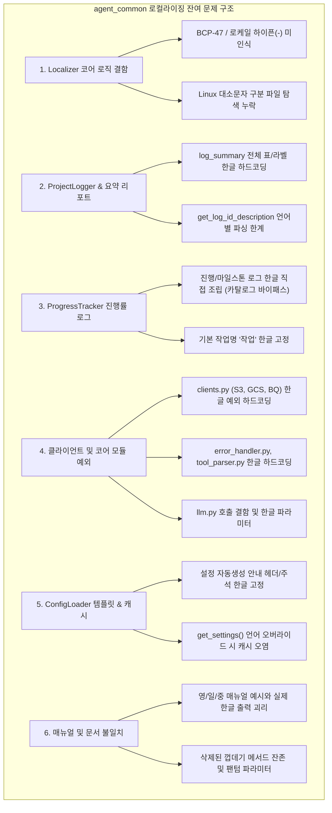

# agent_common 패키지 로컬라이징(Localization) 잔여 문제 및 개선 과제 분석 보고서

> **작성일**: 2026-10-15  
> **대상 패키지**: `agent_common` (v0.4.100 기준)  
> **관련 모듈**: [`localizer.py`](file:///c:/Users/S025164/Downloads/code/bucket_test/agent_common/src/agent_common/localizer.py), [`config_loader.py`](file:///c:/Users/S025164/Downloads/code/bucket_test/agent_common/src/agent_common/config_loader.py), [`logger.py`](file:///c:/Users/S025164/Downloads/code/bucket_test/agent_common/src/agent_common/logger.py), [`progress_tracker.py`](file:///c:/Users/S025164/Downloads/code/bucket_test/agent_common/src/agent_common/progress_tracker.py), [`clients.py`](file:///c:/Users/S025164/Downloads/code/bucket_test/agent_common/src/agent_common/clients.py), [`error_handler.py`](file:///c:/Users/S025164/Downloads/code/bucket_test/agent_common/src/agent_common/error_handler.py), [`tool_parser.py`](file:///c:/Users/S025164/Downloads/code/bucket_test/agent_common/src/agent_common/tool_parser.py), [`llm.py`](file:///c:/Users/S025164/Downloads/code/bucket_test/agent_common/src/agent_common/llm.py)

---

## 1. 개요 및 분석 배경

`agent_common` 패키지는 데이터 파이프라인 및 AI 에이전트 서비스 전반에서 공용으로 사용하는 핵심 인프라 라이브러리입니다. v0.4.98 ~ v0.4.100 릴리스를 거치며 다음과 같은 주요 로컬라이징 개선 작업이 선행되었습니다:
1. ISO 639-1 기반 언어 코드 표준화 (`KO`, `EN`, `ZH`, `JA`) 및 4개 국어 로그 메시지 템플릿 카탈로그 체계 구축 (`logging_messages_{ko,en,ja,zh}.yml`)
2. 언어 판별 및 리소스 탐색 전담 클래스인 [`Localizer`](file:///c:/Users/S025164/Downloads/code/bucket_test/agent_common/src/agent_common/localizer.py) 신설 및 단일 책임 원칙(SRP) 분리
3. [`GcpCredentialResolver`](file:///c:/Users/S025164/Downloads/code/bucket_test/agent_common/src/agent_common/clients.py#L266)의 한글 예외 문장을 다국어 메시지 사전으로 이전

그러나 소스 코드 및 설계 전반을 정밀 감사한 결과, **런타임 언어 설정을 `EN`, `JA`, `ZH`로 변경하더라도 주요 출력(요약 리포트, 진행률, 대부분의 예외 메시지 등)이 여전히 한국어로 하드코딩되어 출력되거나, 로케일 정규화 파싱 결함 및 문서-코드 간 불일치가 존재하는 다수의 잔여 문제**가 식별되었습니다.

본 보고서는 `agent_common`에 남아있는 로컬라이즈 관련 결함과 구조적 과제를 분류별로 상세히 정리하고, 단계별 해결 방안을 제시합니다.

---

## 2. 잔여 로컬라이징 문제 상세 분석



---

### 분류 1. `Localizer` 코어 모듈의 결함 및 미비점

#### 1.1. BCP 47 및 POSIX 로케일 형식 정규화 결함 (Hyphen `-` 및 서브태그 미인식) [조치 완료: v0.4.101]
- **위치**: [`agent_common/localizer.py:81-93`](file:///c:/Users/S025164/Downloads/code/bucket_test/agent_common/src/agent_common/localizer.py#L81-L93), [`agent_common/localizer.py:119-125`](file:///c:/Users/S025164/Downloads/code/bucket_test/agent_common/src/agent_common/localizer.py#L119-L125), [`agent_common/config_loader.py:723-729`](file:///c:/Users/S025164/Downloads/code/bucket_test/agent_common/src/agent_common/config_loader.py#L723-L729)
- **현상**:
  1. `Localizer.normalize_language(lang_str)`는 `LANGUAGE_ALIAS_DICT` 키만 단순 조회합니다.
  2. 만약 호출자가 실무 표준인 `"en-US"`, `"en_US"`, `"ko-KR"`, `"ko_KR"`, `"zh-CN"`, `"ja-JP"` 등을 넘기면, 사전에 매핑되지 않아 무조건 기본 언어인 `"KO"`로 강제 롤백됩니다.
  3. `Localizer.resolve_language()`와 `ConfigLoader._resolve_logging_language()`는 환경변수를 읽을 때 `split(".")[0].split("_")[0]` 처리를 하여 언더스코어(`_`)는 분리하지만, **하이픈(`-`) 구분 로케일(예: `en-US`, `zh-CN`)은 분리하지 못합니다.** 결과적으로 `first_part_str`가 `"EN-US"`가 되어 매칭에 실패하고 기본값 `"KO"`로 떨어집니다.
  4. 더불어 `normalize_language`에는 이 분리 로직조차 없어서 `Localizer.set_global_language("en_US")`나 `Localizer("en_US")`를 호출하면 영어가 아닌 한국어 `"KO"`로 처리됩니다.
- **영향**: 표준 HTTP 헤더(`Accept-Language: en-US`)나 컨테이너 환경변수(`LANG=en-US.UTF-8`) 유입 시 영문 로그가 활성화되지 못하고 한국어로 고정되는 결함 발생.
- **조치 결과 (v0.4.101)**:
  - BCP 47 표준 하이픈(`-`) 구분자 및 서브태그/인코딩 분리 처리를 `normalize_language()`, `resolve_language()`, `ConfigLoader._resolve_logging_language()`에 전면 적용.
  - `"en-US"`, `"ko-KR"`, `"zh-CN"`, `"ja-JP"` 등 BCP 47 표준 로케일 문자열 유입 시 주 언어 코드(`EN`, `KO`, `ZH`, `JA`)로 정확히 정규화되어 기본 언어 롤백 결함 해결 완료.

#### 1.2. 대소문자 구분 OS(Linux/Container) 환경에서의 리소스 파일 탐색 불일치 [검토 완료: 네이밍 표준화로 불요]
- **위치**: [`agent_common/localizer.py:130-171`](file:///c:/Users/S025164/Downloads/code/bucket_test/agent_common/src/agent_common/localizer.py#L130-L171) (`resolve_localized_file`)
- **현상**:
  - `resolve_localized_file`은 `f"{prefix_str}_{lang_suffix_str}{ext_str}"`와 같이 소문자(`_ko`, `_en`, `_ja`, `_zh`)로 직접 `exists()`를 확인하므로, 대문자로 파일명 생성 시 탐색 실패 가능성 존재.
- **검토 결과 및 방침**:
  - 코드 레벨에서 대소문자 무차별 탐색(불필요한 디렉터리 스캔 방어 코드)을 추가하지 않고, **"모든 리소스 파일명은 소문자 접미사(`_ko.yml`, `_en.yml`, `_ja.yml`, `_zh.yml`)로 생성한다"**는 공식 네이밍 표준 규칙을 준수하는 것으로 종결 (Rule 1.1.3 및 방어 코드 금지 철학 준수).

---

### 분류 2. `ProjectLogger` 및 요약 리포트(`log_summary`)의 한글 하드코딩

#### 2.1. `log_summary()` 전체 출력 블록의 한국어 하드코딩
- **위치**: [`agent_common/logger.py:686-826`](file:///c:/Users/S025164/Downloads/code/bucket_test/agent_common/src/agent_common/logger.py#L686-L826)
- **현상**:
  - `manual/en/logger/05_summary_report_generation_en.md`, `manual/ja/...`, `manual/zh/...`에는 각 언어별로 번역된 요약 리포트 마크다운 표가 예시로 수록되어 있습니다.
  - 그러나 실제 `ProjectLogger.log_summary()` 코드는 표 전체 라벨과 서식이 한국어로 완전히 고정되어 있어, `logging.language_str: EN`이나 `JA`, `ZH`로 설정해도 요약 리포트는 100% 한국어로 출력됩니다:
    - 소요 시간: `f"{minutes_int}분 {seconds_float:.1f}초 ({elapsed_float:.2f}초)"` ("분", "초" 고정)
    - 표 헤더: `["구분", "세부 항목", "내용 / 수치", "비고"]`
    - 표 데이터 행:
      - `["실행 시간", "작업 일시", ...]`
      - `["처리 건수", "전체 건수 (Total)", f"{...} 건", "전체 = 성공 + 실패 + 제외"]`
      - `["", "├─ 처리 성공", f"{...} 건", ...]`
      - `["", "├─ 처리 실패", f"{...} 건", ...]`
      - `["", "└─ 처리 제외", f"{...} 건", ...]`
      - `["처리 성능", "평균 처리 속도", ...]`
      - `["", "총 전송 데이터량", ..., f"평균 {...} MB/s"]`
      - `["상세 정보", ...]`
    - 표 제목: `f"[{task_name_str} 작업 결과 요약 표]"`
    - 하단 세부 목록:
      - `f"- 예외/오류 발생 세부 내역 (총 {total_errors_int:,}건):"`
      - `f"  * {error_log_id_str} ({description_str}): {error_count_int:,} 건"`
      - `f"  * 기타 미분류 실패: {effective_failure_count_int:,} 건"`
      - `f"- 처리 제외 세부 내역 (총 {total_excluded_items_int:,}건):"`
- **규칙 위반**: AGENTS.md 규칙 1.1.1 (소스 코드 내 UI 라벨/로그 메시지 직접 하드코딩 금지) 위반.

#### 2.2. `get_log_id_description()`의 언어별 템플릿 파싱 구조적 한계 [조치 완료: v0.4.101]
- **위치**: [`agent_common/logger.py:532-580`](file:///c:/Users/S025164/Downloads/code/bucket_test/agent_common/src/agent_common/logger.py#L532-L580)
- **현상**:
  - `get_log_id_description()`은 템플릿 문자열에서 첫 번째 콜론(`:`) 앞부분 및 대괄호(`[...]`) 뒤 텍스트를 파싱하여 요약 표에 표시할 설명 문구를 추출했습니다.
  - 이 방식은 한국어 템플릿의 특정 어순에만 맞춰져 있어, 영문("Failed to connect to {service_name_str}: {error_str}"), 중문, 일문 템플릿의 경우 콜론 앞 단어가 어색하게 잘리거나 부가설명 괄호 `(Path: ...)`의 콜론에서 조기 절단되는 결함이 있었습니다.
- **조치 결과 (v0.4.101)**:
  - **소괄호 `()` 내용 제거**: `re.sub(r"\([^)]*\)", "", text)`를 선행하여 문장 중간의 `(Path: ...)`나 `(Lock)` 등 부가정보로 인한 조기 절단 원천 차단.
  - **마침표 및 콜론 정규 절단**: `re.split(r":|：|\.\s+|\。|\.$", ...)`를 적용하여 첫 마침표(문장 종결) 또는 콜론에서 절단하되, 파일 확장자(`config.yml`)나 소수점 오인 절단 방지.
  - **문장 끝 잔여 에러 키워드 정제**: 끝단에 남는 `, error`, `, 에러`를 자동 정제.
  - **`service_name_str` 인스턴스 변수 바인딩**: `ProjectLogger(..., service_name_str="...")` 및 `self.service_name_str`을 지원하여 `get_log_msg` 및 `get_log_id_description`에서 `{service_name_str}`를 자동 치환함으로써 완성형 문맥 제공.
  - **미치환 플레이스홀더 `{}` 보존**: 전치사 뒤 빈 공간으로 문법이 파괴되는 문제를 방지하고 템플릿 파라미터 자리 유지.

---

### 분류 3. `ProgressTracker` 진행률 및 마일스톤 로그의 하드코딩 및 카탈로그 미연동

#### 3.1. `ProgressTracker.update()`의 한글 포매팅 직접 출력
- **위치**: [`agent_common/progress_tracker.py:117-135`](file:///c:/Users/S025164/Downloads/code/bucket_test/agent_common/src/agent_common/progress_tracker.py#L117-L135)
- **현상**:
  - `ProgressTracker.update()`는 진행률 마일스톤 및 일반 진행 로그를 출력할 때 메시지 카탈로그(`logging_messages_*.yml`)의 코드 템플릿을 호출하지 않고, 아래와 같이 소스 코드 내에서 완전한 한글 문자열을 직접 조립하여 `logger.warning(msg_str)`, `logger.info(msg_str)`로 넘깁니다:
    ```python
    # 마일스톤 경고 로그 (117-124행)
    msg_str = (
        f"[{self.task_name_str} 진행률 마일스톤] "
        f"진행: {self.current_count_int:,}/{self.total_items_int:,} ({current_percent_int}%) | "
        f"속도: {items_per_second_float:.1f}건/s {speed_mb_str} | 남은시간(ETA): {eta_str}"
    )
    # 일반 진행 로그 (127-135행)
    msg_str = (
        f"[{self.task_name_str}] {self.current_count_int:,}/{self.total_items_int:,} ({current_percent_int}%) | "
        f"{items_per_second_float:.1f}건/s"
    )
    ```
  - `logging_messages_*.yml`에 `progress_tracker_milestone`이나 `progress_tracker_update` 같은 표준 템플릿 키가 없고 소스 코드에 한글이 고정되어 있어, 다국어 환경에서도 진행률 로그가 무조건 한국어로만 찍힙니다.

#### 3.2. 스키마 기본값 `default_task_name_str`의 한글 고정
- **위치**: [`agent_common/progress_tracker.py:25`](file:///c:/Users/S025164/Downloads/code/bucket_test/agent_common/src/agent_common/progress_tracker.py#L25), [`agent_common/config/default_agent_common.yml:31`](file:///c:/Users/S025164/Downloads/code/bucket_test/agent_common/src/agent_common/config/default_agent_common.yml#L31)
- **현상**:
  - `default_task_name_str: "작업"`으로 하드코딩되어 있어, 영문 환경 등에서 작업명을 명시적으로 지정하지 않으면 `"[작업] ..."`으로 표시됩니다.

---

### 분류 4. `clients.py` 내 예외 메시지의 한글 하드코딩 및 다국어 카탈로그 미연동

#### 4.1. `GcpCredentialResolver` 외 타 클라이언트의 예외 하드코딩 방치
- **위치**: [`agent_common/clients.py`](file:///c:/Users/S025164/Downloads/code/bucket_test/agent_common/src/agent_common/clients.py)
- **현상**:
  - v0.4.98에서 `GcpCredentialResolver`의 예외 문장 3개(`credential_package_missing`, `credential_json_invalid`, `credential_file_not_found`)는 `logging_messages_*.yml`로 성공적으로 분리되었습니다.
  - 하지만 같은 파일 내의 `S3Client`, `GcsClient`, `BigQueryClient`는 여전히 다수의 예외 메시지가 한국어로 하드코딩되어 있습니다:
    | 클래스 | 라인 | 하드코딩된 예외 코드 |
    | :--- | :--- | :--- |
    | `S3Client` | 60행 | `raise ImportError("AWS S3 및 Dell ECS 기능을 사용하려면 'boto3' 패키지가 필요합니다. 'pip install boto3' 또는 'pip install agent_common[clients]'로 설치해 주십시오.")` |
    | `S3Client` | 91행 | `raise ValueError("S3/ECS 버킷명(bucket_name_str)은 필수 입력 항목입니다.")` |
    | `GcsClient` | 396행 | `raise ImportError("Google Cloud Storage(GCS) 기능을 사용하려면 'google-cloud-storage' 패키지가 필요합니다. ...")` |
    | `GcsClient` | 416행 | `raise ValueError("GCS 버킷명(bucket_name_str)은 필수 입력 항목입니다.")` |
    | `GcsClient` | 521행 | `raise ValueError("GCS 전체 삭제 방지를 위해 유효한 prefix_str 지정은 필수입니다.")` |
    | `GcsClient` | 566행 | `raise ValueError("삭제할 GCS blob 경로명(destination_blob_name_str)은 필수 입력 항목입니다.")` |
    | `BigQueryClient` | 617행 | `raise ImportError("Google Cloud BigQuery 기능을 사용하려면 'google-cloud-bigquery' 패키지가 필요합니다. ...")` |
    | `BigQueryClient` | 755, 841, 1101행 | `raise ValueError(f"지원하지 않는 JSON 데이터 포맷 구조입니다: {type(json_data_any)}")` |
    | `BigQueryClient` | 860행 | `raise RuntimeError(f"BigQuery API insert 반환 상세 에러: {combined_error_message_str}")` |
    | `BigQueryClient` | 1010행 | `raise ValueError("BigQuery DELETE DML 조건식(where_clause_str)은 필수 입력 항목입니다 (전체 삭제 방지).")` |
    | `BigQueryClient` | 1019행 | `raise ValueError(f"전체 삭제를 유발할 수 있는 위험한 조건식입니다: {where_clause_str}")` |
- **영향**: 글로벌 환경이나 다국어 로그 설정 상태에서도 예외 스택트레이스(Traceback) 및 에러 안내가 무조건 한국어로만 노출됩니다.

---

### 분류 5. `error_handler.py`, `tool_parser.py`, `llm.py` 내 한글 하드코딩 및 버그

#### 5.1. `error_handler.py`의 로그 서식 및 응답 메시지 한글 하드코딩
- **위치**: [`agent_common/error_handler.py:116-163`](file:///c:/Users/S025164/Downloads/code/bucket_test/agent_common/src/agent_common/error_handler.py#L116-L163)
- **현상**:
  - 116행: `self.logger.warning("fastapi 패키지가 설치되어 있지 않아 FastAPI 예외 핸들러를 등록할 수 없습니다.")`
  - 131행: `self.logger.error("generate_sql_no_models - 서버 내부 오류 발생: %s", err_msg)`
  - 138행: `self.logger.warning("generate_sql_failed - SQL 생성 실패 경고: %s", err_msg)`
  - 148행: `self.logger.warning("metricflow_operation_failed - MetricFlow 처리 중 에러 발생: %s", err_msg)`
  - 159행: `self.logger.warning("invalid_argument_error - 입력값 형식 오류 발생: %s", err_msg)`
  - 메시지 카탈로그 템플릿 조회를 거치지 않고 `%s` 포맷 스트링 및 한국어 문장이 직접 바인딩되어 있습니다.

#### 5.2. `tool_parser.py`의 예외 메시지 한글 하드코딩
- **위치**: [`agent_common/tool_parser.py:55-198`](file:///c:/Users/S025164/Downloads/code/bucket_test/agent_common/src/agent_common/tool_parser.py#L55-L198)
- **현상**:
  - 55행: `raise AttributeError(f"'{type(data_obj).__name__}' 객체는 '{name_str}' 속성을 지원하지 않습니다.")`
  - 59행: `raise AttributeError(f"필드 '{name_str}'가 존재하지 않습니다.")`
  - 67행: `raise KeyError(f"미정의 변수 '{key_str}'를 참조할 수 없습니다.")`
  - 198행: `raise ValueError(f"Tool 함수 '{func_name_str}'를 찾을 수 없습니다.")`
  - 동적 도구 파싱 및 템플릿 치환 중 발생하는 예외 메시지가 한국어로 고정되어 있습니다.

#### 5.3. `llm.py`의 인스턴스 메서드 클래스 직접 호출 결함 및 한글 파라미터 전달
- **위치**: [`agent_common/llm.py:419`](file:///c:/Users/S025164/Downloads/code/bucket_test/agent_common/src/agent_common/llm.py#L419), [`agent_common/llm.py:93-312`](file:///c:/Users/S025164/Downloads/code/bucket_test/agent_common/src/agent_common/llm.py#L93-L312)
- **현상**:
  1. **실행 시 런타임 결함**:
     ```python
     # agent_common/llm.py:419
     msg_str = ProjectLogger.get_log_msg("ERROR", "config_load_failed", error_str="llama-cpp-python 패키지가 설치되어 있지 않습니다.")
     ```
     `ProjectLogger.get_log_msg`는 첫 번째 인자가 `self`인 **인스턴스 메서드**입니다. 이를 클래스(`ProjectLogger.get_log_msg`)에서 직접 호출하면 첫 번째 인자인 `"ERROR"`가 `self`로 전달되어 `self._search_template_in_level` 호출 시 `AttributeError: 'str' object has no attribute '_search_template_in_level'`이 발생합니다.
  2. **한글 하드코딩 파라미터 전달**:
     - 93행: `error_str=f"llmpool.yml 내 '{self.model_name_str}' 모델 설정이 누락되었습니다."`
     - 125행: `error_str=f"지원하지 않는 LLM_PROVIDER 설정입니다: {provider_str}"`
     - 217, 219, 226행: `service_name_str="외부 LLM API"`
     - 템플릿의 슬롯 변수(`error_str`, `service_name_str`)에 한국어 문장이 하드코딩되어 전달되므로 템플릿 언어를 영문으로 바꿔도 슬롯 내용은 한국어로 남게 됩니다.

---

### 분류 6. `ConfigLoader` 설정 파일 자동 생성/보정(Self-Healing) 템플릿의 한글 하드코딩 및 캐시 변조

#### 6.1. `config_notice_header_str` 및 `config_repair_inline_comment_str` 다국어 미지원
- **위치**: [`agent_common/config_loader.py:44-56`](file:///c:/Users/S025164/Downloads/code/bucket_test/agent_common/src/agent_common/config_loader.py#L44-L56), [`agent_common/config/default_agent_common.yml:34-45`](file:///c:/Users/S025164/Downloads/code/bucket_test/agent_common/src/agent_common/config/default_agent_common.yml#L34-L45)
- **현상**:
  - `ensure_config_file()`이 기동 시점에 `config.yml`을 자동 생성하거나 누락된 키를 보정할 때 삽입하는 주석 헤더가 한국어로만 고정되어 있습니다:
    ```yaml
    # ==============================================================================
    # [안내 / NOTICE]
    # 본 설정 파일({config_file_name})은 프로그램 실행 시 기존 파일이 존재하지 않아
    # 기본 템플릿 스키마로 자동 생성되었습니다.
    ...
    config_repair_inline_comment_str: "# [자동 추가: {now_dt_str}]"
    ```
  - 해외 배포 환경이나 영어 환경에서도 설정 파일에 한국어 안내문 및 주석이 강제 생성됩니다.

#### 6.2. `ConfigLoader.get_settings()` 내 언어 해석 후 설정 딕셔너리 원본 변조(In-place Mutation) 부작용
- **위치**: [`agent_common/config_loader.py:787-788`](file:///c:/Users/S025164/Downloads/code/bucket_test/agent_common/src/agent_common/config_loader.py#L787-L788)
- **현상**:
  - `get_settings()` 내부에서:
    ```python
    selected_lang_str: str = self._resolve_logging_language(settings)
    ...
    settings["logging"]["language"] = selected_lang_str
    settings["logging"]["language_str"] = selected_lang_str
    ```
  - 만약 환경변수 `AGENT_LOG_LANGUAGE="EN"`에 의해 `selected_lang_str`이 `"EN"`으로 결정되면, 캐시되는 `settings` 딕셔너리 내부의 `settings["logging"]["language_str"]` 값을 `"EN"`으로 덮어씁니다.
  - 이후 런타임에 해당 환경변수가 해제되더라도, `_resolve_logging_language(self._cached_settings)`가 `settings_dict["logging"]["language_str"]`를 조회할 때 이미 덮어씌워진 `"EN"`을 읽게 되어 본래 `config.yml`에 지정되어 있던 값(`KO` 등)으로 복구되지 못하는 **캐시 오염 문제**가 발생합니다.

---

### 분류 7. 매뉴얼, 문서 및 규칙 간 불일치

#### 7.1. 4개 국어 매뉴얼과 실제 구현 간 괴리
- **위치**: [`agent_common/manual/en/logger/05_summary_report_generation_en.md`](file:///c:/Users/S025164/Downloads/code/bucket_test/agent_common/manual/en/logger/05_summary_report_generation_en.md), `manual/ja/...`, `manual/zh/...`
- **현상**:
  - 영/일/중 매뉴얼 2.5절에는 `[Data Pipeline Migration Summary]`, `- Total Elapsed Time: ...`, `- Succeeded / Failed: ...`처럼 완전한 영문/다국어 요약 리포트 표가 출력되는 것으로 안내되어 있으나, 실제 코드는 분류 2.1에서 보았듯이 한국어로 하드코딩되어 있습니다.
  - 또한 `manual/*/localizer/01_language_codes_and_resource_lookup_*.md` 5절 메서드 규격에 v0.4.100에서 껍데기 함수 금지(규칙 1.4.6)에 따라 제거된 `resolve_catalog_file()`, `resolve_project_catalog_file()`이 여전히 설명되어 있어 사용자가 이를 호출할 경우 `AttributeError`가 발생합니다.

#### 7.2. `README.md` 사용 예시의 팬텀(존재하지 않는) 파라미터
- **위치**: [`agent_common/README.md:120`](file:///c:/Users/S025164/Downloads/code/bucket_test/agent_common/README.md#L120)
- **현상**:
  - `README.md` 3절 예시:
    ```python
    tracker = ProgressTracker(total_items_int=1000, logger_obj=logger, item_name_str="파일")
    ```
  - 실제 [`ProgressTracker.__init__`](file:///c:/Users/S025164/Downloads/code/bucket_test/agent_common/src/agent_common/progress_tracker.py#L38-L55)에는 `item_name_str` 파라미터가 선언되어 있지 않습니다.
  - 규칙 1.5.3에 따라 `**kwargs`가 금지되어 있으므로, 사용자가 README 예시 코드를 복사하여 실행하면 즉시 `TypeError: ProgressTracker.__init__() got an unexpected keyword argument 'item_name_str'` 오류가 발생합니다.

#### 7.3. `AGENTS.md` 규칙 3.1과 다국어 지원 정책의 정합성 가이드 정리 필요
- **내용**:
  - `AGENTS.md` 3.1조: *"3.1. Korean Log Output: All application runtime log messages (INFO, WARNING, ERROR) must be written in clear Korean."*
  - `agent_common`의 공식 지원 기능: 4개 국어 메시지 카탈로그(`KO`, `EN`, `ZH`, `JA`) 및 런타임 언어 선택 기능.
  - 규칙 3.1과 다국어 카탈로그 기능 간의 관계가 명확히 서술되어야 합니다:
    - *“기본 로그 출력 및 개발 표준은 명확한 한국어를 원칙으로 하되, `logging.language_str` 또는 `AGENT_LANGUAGE` 설정이 부여된 경우에는 해당 다국어 카탈로그의 정규 메시지를 우선 출력하도록 지원한다.”*

---

## 3. 우선순위별 해결 로드맵 (Actionable Roadmap)

| 우선순위 | 항목 | 대상 파일 | 주요 작업 내용 |
| :---: | :--- | :--- | :--- |
| **P1**<br>(즉시 조치 / 버그) | **`llm.py` 메서드 호출 결함 및 구조 통합** | [`llm.py`](file:///c:/Users/S025164/Downloads/code/bucket_test/agent_common/src/agent_common/llm.py#L419) | **[완료: v0.4.101]** `_get_local_llm`을 `LlmClient` 내부 인스턴스 메서드로 통합하여 클래스 78행의 `self.logger`를 직접 사용하도록 개선 및 런타임 오류 해결 |
| **P1**<br>(즉시 조치 / 버그) | **`Localizer` 로케일 하이픈/서브태그 정규화 개선** | [`localizer.py`](file:///c:/Users/S025164/Downloads/code/bucket_test/agent_common/src/agent_common/localizer.py#L81) | **[완료: v0.4.101]** `normalize_language()` 및 `resolve_language()`에서 BCP 47 표준 하이픈(`-`), `_`, `.` 분리 지원으로 `en-US`, `zh-CN` 등 표준 로케일 유입 시 정확한 언어 코드 매핑 보장 |
| **P1**<br>(즉시 조치 / 버그) | **`ConfigLoader` 언어 해석 캐시 오염 방지** | [`config_loader.py`](file:///c:/Users/S025164/Downloads/code/bucket_test/agent_common/src/agent_common/config_loader.py#L787) | **[완료: v0.4.101]** `settings["logging"]["language_str"]`를 인플레이스로 변조하지 않고 원본 설정값(`_raw_configured_logging_language_str`)을 별도 보존하여 환경변수 해제 시 정상 복원 보장 |
| **P1**<br>(즉시 조치 / 문서) | **`README.md` 팬텀 파라미터 정정** | [`README.md`](file:///c:/Users/S025164/Downloads/code/bucket_test/agent_common/README.md#L120) | **[완료: v0.4.101]** `ProgressTracker(..., item_name_str="파일")` 및 미지원 `log_summary()`를 정규 `task_name_str="파일 처리"` 및 `tracker.update(...)` 예시로 정정 |
| **P2**<br>(핵심 로컬라이징) | **`log_summary()` 전용 리포터 분리 및 백업** | [`logger.py`](file:///c:/Users/S025164/Downloads/code/bucket_test/agent_common/src/agent_common/logger.py#L686) | **[완료: v0.4.101]** 프로젝트별 요약 형식 상이에 따라 `backup/log_summary/log_summary_backup.py`로 안전 백업 후 `ProjectLogger`에서 제거, 개별 전용 요약 리포터 활용 원칙 확립 |
| **P2**<br>(핵심 로컬라이징) | **`get_log_id_description()` 다국어 파싱 개선** | [`logger.py`](file:///c:/Users/S025164/Downloads/code/bucket_test/agent_common/src/agent_common/logger.py#L543) | **[완료: v0.4.101]** 괄호 부가설명 선제거, 마침표/콜론 정규 절단, `self.service_name_str` 바인딩 치환 및 플레이스홀더 보존으로 다국어 요약 레이블 정합성 확보 |
| **P2**<br>(핵심 로컬라이징) | **`ProgressTracker` 진행률 로그 다국어화** | [`progress_tracker.py`](file:///c:/Users/S025164/Downloads/code/bucket_test/agent_common/src/agent_common/progress_tracker.py#L117) | **[완료: v0.4.101]** `DEFAULT_TASK_NAMES_DICT` 및 `PROGRESS_LABELS_DICT`를 통한 4개 국어(KO, EN, JA, ZH) 기본 작업명 및 마일스톤/속도/ETA 라벨 자동 번역 지원 |
| **P2**<br>(문서 정합성) | **매뉴얼 내 삭제된 껍데기 메서드 정리** | [`manual/*/localizer/*.md`](file:///c:/Users/S025164/Downloads/code/bucket_test/agent_common/manual/ko/localizer/01_language_codes_and_resource_lookup_ko.md) | **[추후 일괄 개정 예정]** 4개 국어 매뉴얼 일괄 업데이트 작업 시 일괄 정비 |
| **P3**<br>(예외 다국어화) | **`clients.py` 예외 메시지 카탈로그 분리** | [`clients.py`](file:///c:/Users/S025164/Downloads/code/bucket_test/agent_common/src/agent_common/clients.py) | `GcpCredentialResolver` 패턴과 동일하게 S3, GCS, BigQuery의 패키지 미설치 및 필수값 누락 안내 문구를 카탈로그로 이전 검토 |
| **P3**<br>(예외 다국어화) | **`error_handler.py`, `tool_parser.py` 메시지 정비** | [`error_handler.py`](file:///c:/Users/S025164/Downloads/code/bucket_test/agent_common/src/agent_common/error_handler.py), [`tool_parser.py`](file:///c:/Users/S025164/Downloads/code/bucket_test/agent_common/src/agent_common/tool_parser.py) | 하드코딩된 에러 안내문구의 카탈로그 키 연동 검토 |
| **P4**<br>(시스템 및 설정) | **`Localizer` Linux 대소문자 파일 탐색 보완** | [`localizer.py`](file:///c:/Users/S025164/Downloads/code/bucket_test/agent_common/src/agent_common/localizer.py#L158) | **[완료: v0.4.101]** `resolve_localized_file`이 `resolve_localized_path_from_list`에 위임하여 Linux/Windows 모두 대소문자 무관 탐색 보장 |
| **P4**<br>(시스템 및 설정) | **설정 자동생성/보정 템플릿 다국어 지원** | [`config_loader.py`](file:///c:/Users/S025164/Downloads/code/bucket_test/agent_common/src/agent_common/config_loader.py#L44) | `templates.config_notice_header_str`의 언어별 템플릿 지원 검토 |

---

## 4. 결론

현재 `agent_common`은 로그 메시지 템플릿 자체(`logging_messages_{ko,en,ja,zh}.yml`)에 대해서는 136개 고유 키가 4개 국어로 완벽하게 1:1 동기화되어 있으며 토큰 치환 정합성도 우수합니다.

그러나 **그 템플릿을 소비하고 실행하는 코드 영역(`log_summary`, `ProgressTracker`, `clients.py`, `error_handler.py`, `tool_parser.py`)에 여전히 많은 한국어 문자열이 하드코딩**되어 있어, 다국어 설정 시에도 사용자 및 운영자 화면에 한국어가 혼재되어 출력되는 불완전한 상태입니다.

위의 로드맵에 따라 **P1(버그 및 로케일 파싱 결함)을 즉시 조치**하고, **P2(요약표 및 진행률 로그 카탈로그화)**를 순차 적용함으로써 완전하고 안정적인 글로벌 다국어 지원 인프라를 완성할 수 있습니다.
