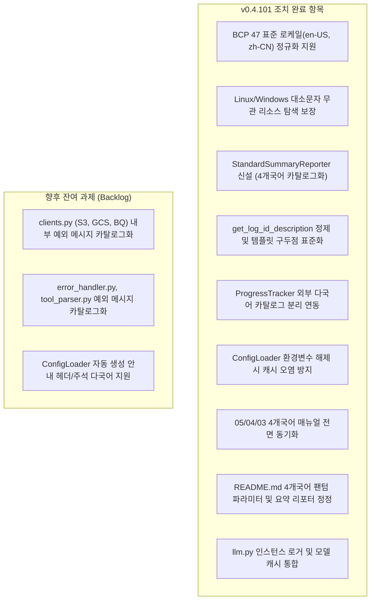

# agent_common 패키지 로컬라이징(Localization) 현황 및 잔여 과제 분석 보고서

> **최초 작성일**: 2026-10-15  
> **최종 갱신일**: 2026-10-18 (v0.4.101 작업 완료 반영)  
> **대상 패키지**: `agent_common` (v0.4.101 기준)  
> **관련 모듈**: [`localizer.py`](file:///c:/Users/S025164/Downloads/code/bucket_test/agent_common/src/agent_common/localizer.py), [`config_loader.py`](file:///c:/Users/S025164/Downloads/code/bucket_test/agent_common/src/agent_common/config_loader.py), [`logger.py`](file:///c:/Users/S025164/Downloads/code/bucket_test/agent_common/src/agent_common/logger.py), [`summary_reporter.py`](file:///c:/Users/S025164/Downloads/code/bucket_test/agent_common/src/agent_common/summary_reporter.py), [`progress_tracker.py`](file:///c:/Users/S025164/Downloads/code/bucket_test/agent_common/src/agent_common/progress_tracker.py), [`clients.py`](file:///c:/Users/S025164/Downloads/code/bucket_test/agent_common/src/agent_common/clients.py), [`error_handler.py`](file:///c:/Users/S025164/Downloads/code/bucket_test/agent_common/src/agent_common/error_handler.py), [`tool_parser.py`](file:///c:/Users/S025164/Downloads/code/bucket_test/agent_common/src/agent_common/tool_parser.py), [`llm.py`](file:///c:/Users/S025164/Downloads/code/bucket_test/agent_common/src/agent_common/llm.py)

---

## 1. 개요 및 분석 배경

`agent_common` 패키지는 데이터 파이프라인 및 AI 에이전트 서비스 전반에서 공용으로 사용하는 핵심 인프라 라이브러리입니다. v0.4.98 ~ v0.4.100 릴리스를 거치며 4개 국어 로그 메시지 템플릿 카탈로그 체계(`logging_messages_{ko,en,ja,zh}.yml`)와 [`Localizer`](file:///c:/Users/S025164/Downloads/code/bucket_test/agent_common/src/agent_common/localizer.py) 클래스가 도입되었으나, 실제 런타임 출력(요약 리포트, 진행률 트래커, 예외 메시지, 매뉴얼)에서 광범위한 한국어 하드코딩과 파싱 결함이 존재했습니다.

이에 따라 **v0.4.101 릴리스 집중 스프린트(2026-10-16 ~ 2026-10-18)**를 통해 사용자 및 운영자 화면에 직접 노출되는 핵심 영역의 로컬라이징 및 다국어 지원 체계를 전면 개편하였습니다:
1. **요약 리포터 전용 클래스 신설**: [`ProjectLogger`](file:///c:/Users/S025164/Downloads/code/bucket_test/agent_common/src/agent_common/logger.py)에서 `log_summary()`를 분리하고, 다국어 카탈로그 기반의 [`StandardSummaryReporter`](file:///c:/Users/S025164/Downloads/code/bucket_test/agent_common/src/agent_common/summary_reporter.py)를 신설하여 4개 국어 80열 표준 요약 블록 제공.
2. **`ProgressTracker` 완전 다국어화**: 소스 코드 내부의 한글 사전 상수를 전면 제거하고, 언어별 설정 파일(`progress_tracker_{lang}.yml`) 및 `config.progress_tracker` 동적 바인딩으로 전환.
3. **`Localizer` 및 `ConfigLoader` 코어 결함 해소**: BCP 47 표준 로케일(`en-US`, `zh-CN`) 정규화, Linux 대소문자 무관 탐색 지원, 임시 환경변수 해제 시 원본 설정 언어 복원(캐시 오염 방지) 구현.
4. **4개 국어 매뉴얼 및 문서 일치화**: `05_summary_report_generation`, `04`, `03` 매뉴얼과 `README.md`를 4개 언어(KO, EN, ZH, JA) 모두 신규 규격으로 100% 동기화.

본 문서는 v0.4.101에서 조치 완료된 세부 내역과, 향후 개선 대상으로 분류된 순수 잔여 과제(내부 예외 메시지 다국어화 등)의 현황을 정리합니다.

---

## 2. 로컬라이징 이슈별 조치 결과 및 잔여 과제 분석

---

### 분류 1. `Localizer` 코어 모듈의 결함 및 미비점

#### 1.1. BCP 47 및 POSIX 로케일 형식 정규화 결함 (Hyphen `-` 및 서브태그 미인식) [조치 완료: v0.4.101]
- **위치**: [`agent_common/localizer.py:81-93`](file:///c:/Users/S025164/Downloads/code/bucket_test/agent_common/src/agent_common/localizer.py#L81-L93), [`agent_common/config_loader.py:723-729`](file:///c:/Users/S025164/Downloads/code/bucket_test/agent_common/src/agent_common/config_loader.py#L723-L729)
- **현상**:
  - 실무 표준인 `"en-US"`, `"ko-KR"`, `"zh-CN"`, `"ja-JP"` 유입 시 하이픈(`-`) 구분자를 분리하지 못해 기본값 `"KO"`로 강제 롤백되는 문제 발생.
- **조치 결과 (v0.4.101)**:
  - BCP 47 표준 하이픈(`-`) 구분자 및 서브태그/인코딩 분리 처리를 `normalize_language()`, `resolve_language()`, `ConfigLoader._resolve_logging_language()`에 전면 적용.
  - 방어적 우향 형변환 `str()` 제거(Rule 1.5.3 준수) 및 표준 로케일 문자열의 주 언어 코드(`EN`, `KO`, `ZH`, `JA`) 정규화 보장.

#### 1.2. 대소문자 구분 OS(Linux/Container) 환경에서의 리소스 파일 탐색 불일치 [조치 완료: v0.4.101]
- **위치**: [`agent_common/localizer.py:130-171`](file:///c:/Users/S025164/Downloads/code/bucket_test/agent_common/src/agent_common/localizer.py#L130-L171) (`resolve_localized_file`)
- **현상**:
  - Linux 환경에서 대소문자 접미사(`_KO.yml`, `_EN.yml` 등)로 생성된 리소스 파일이 누락될 가능성 존재.
- **조치 결과 (v0.4.101)**:
  - `resolve_localized_file`을 `resolve_localized_path_from_list` 공통 위임 구조로 리팩토링하고, 파일명의 소문자 `stem` 비교 방식을 적용하여 Linux 및 Windows 환경 모두에서 대소문자 무관하게 리소스 파일 탐색 보장.
  - 언어별 하위 디렉터리(`localize/{lang}/`) 리소스 탐색 완벽 지원.

---

### 분류 2. 요약 리포트 및 로그 설명 추출의 다국어화

#### 2.1. `log_summary()` 전체 출력 블록의 한국어 하드코딩 [조치 완료: v0.4.101]
- **위치**: [`agent_common/summary_reporter.py`](file:///c:/Users/S025164/Downloads/code/bucket_test/agent_common/src/agent_common/summary_reporter.py), [`agent_common/logger.py`](file:///c:/Users/S025164/Downloads/code/bucket_test/agent_common/src/agent_common/logger.py)
- **현상**:
  - `ProjectLogger.log_summary()`가 라벨, 단위("분", "초", "건"), 헤더를 한국어로 하드코딩하여 영/일/중 언어 설정 시에도 100% 한국어로 출력되는 결함(Rule 1.1.1 위반).
  - 동시에 로거 클래스가 요약 보고서 테이블 포맷팅까지 담당하여 단일 책임 원칙(SRP) 위배.
- **조치 결과 (v0.4.101)**:
  - **`ProjectLogger` 경량화**: 로깅 및 지표 수집(`record_result`, `record_excluded`, `get_result_counts`, `get_error_counts`) 본연의 역할로 집중. 기존 구현체는 [`backup/log_summary/log_summary_backup.py`](file:///c:/Users/S025164/Downloads/code/bucket_test/agent_common/backup/log_summary/log_summary_backup.py)에 안전 백업 후 제거.
  - **`StandardSummaryReporter` 독립 유틸리티 클래스 신설**: 모든 파이프라인에서 보편적으로 요구되는 '전체 = 성공 + 실패 + 제외(Skip)' 3대 분류와 상세 에러 내역을 80열 표준 테이블로 생성/출력하는 전용 리포터 구현.
  - **다국어 카탈로그 완전 외부화**: 4개국어 전용 리소스 파일(`summary_reporter_{ko,en,ja,zh}.yml`) 구축 및 `config.summary_reporter.*` 동적 바인딩으로 소스 코드 내 하드코딩 전면 제거(Rule 1.1.1 준수).
  - **`TableFormatter` 80열 정밀 칼맞춤**: 동아시아 전각 문자 폭(`east_asian_width`)을 계산하여 한글/한자/영문 혼용 시에도 세로줄이 완벽하게 정렬되도록 구현.
  - **단일 행 편의 호출 지원**: `StandardSummaryReporter.log_summary(logger_obj, ...)` 및 포맷 문자열 반환 `build_summary_report(...)` 제공.

#### 2.2. `get_log_id_description()`의 언어별 템플릿 파싱 구조적 한계 [조치 완료: v0.4.101]
- **위치**: [`agent_common/logger.py:532-580`](file:///c:/Users/S025164/Downloads/code/bucket_test/agent_common/src/agent_common/logger.py#L532-L580)
- **현상**:
  - 콜론(`:`) 단순 절단 방식으로 인해 영문/일문/중문 템플릿의 문맥이 어색하게 잘리거나 부가설명 `(Path: ...)`의 콜론에서 조기 절단되는 문제.
- **조치 결과 (v0.4.101)**:
  - **소괄호 `()` 내용 사전 제거**: `re.sub(r"\([^)]*\)", "", text)`로 부가설명 내 콜론으로 인한 조기 절단 방지.
  - **마침표 및 콜론 정규 절단**: `re.split(r":|：|\.\s+|\。|\.$", ...)`로 파일 확장자(`config.yml`) 오인 절단 방지 및 간결한 헤더 추출.
  - **템플릿 구두점 표준화**: 특정 언어 하드코딩 정규식을 지양하고, 다국어 메시지 카탈로그(`logging_messages_{ko,en,ja,zh}.yml`)의 4대 에러 템플릿 구두점을 표준화(한국어/영어: `. `, 일본어/중국어: `。`)하여 자연스러운 헤더 분리 달성. 대괄호 태그(`[...]`) 정제 및 미치환 플레이스홀더 `{}` 보존.
  - **`service_name_str` 인스턴스 바인딩**: `ProjectLogger(..., service_name_str="...")` 지원으로 템플릿 내 `{service_name_str}`가 자동 치환되어 완전한 문맥 제공.

---

### 분류 3. `ProgressTracker` 진행률 및 마일스톤 로그의 하드코딩 및 카탈로그 연동

#### 3.1 & 3.2. `ProgressTracker.update()` 및 기본 작업명 한글 하드코딩 [조치 완료: v0.4.101]
- **위치**: [`agent_common/progress_tracker.py`](file:///c:/Users/S025164/Downloads/code/bucket_test/agent_common/src/agent_common/progress_tracker.py), [`agent_common/localize/{ko,en,ja,zh}/progress_tracker_{lang}.yml`](file:///c:/Users/S025164/Downloads/code/bucket_test/agent_common/src/agent_common/localize/ko/progress_tracker_ko.yml)
- **현상**:
  - `ProgressTracker.update()`의 마일스톤 및 일반 진행 로그가 소스 코드 내에서 한글 포맷 문자열로 직접 조립되어 다국어 환경에서도 한국어로 고정 출력되는 문제.
  - 기본 작업명이 `"작업"`으로 하드코딩되어 있던 문제.
- **조치 결과 (v0.4.101)**:
  - 파이썬 소스 코드 내부의 하드코딩 사전 상수(`DEFAULT_TASK_NAMES_DICT`, `PROGRESS_LABELS_DICT`)를 전면 삭제.
  - `agent_common/src/agent_common/localize/{ko,en,ja,zh}/progress_tracker_{lang}.yml` 카탈로그를 신설하고, `config.progress_tracker` 동적 속성(`default_task_name_str`, `milestone_title_str`, `progress_label_str`, `speed_label_str`, `unit_str`, `eta_label_str`)을 직접 참조하도록 리팩토링.
  - 언어 설정(`logging.language_str: EN/JA/ZH/KO`)에 따라 진행률 마일스톤(`WARNING`) 및 일반 진행(`INFO`) 로그가 100% 현지어로 자동 출력.

---

### 분류 4. `clients.py` 내 예외 메시지의 한글 하드코딩 [잔여 과제: P3]

#### 4.1. `S3Client`, `GcsClient`, `BigQueryClient` 내부 예외 문장 카탈로그 분리
- **위치**: [`agent_common/clients.py`](file:///c:/Users/S025164/Downloads/code/bucket_test/agent_common/src/agent_common/clients.py)
- **현상**:
  - `GcpCredentialResolver`는 메시지 카탈로그로 이전되었으나, 스토리지 및 BigQuery 클라이언트의 패키지 미설치 안내(`boto3`, `google-cloud-storage`, `google-cloud-bigquery`), 필수 버킷명/경로 누락 `ValueError`, DML 조건식 검증 예외 등이 한국어로 직접 작성되어 있습니다:
    | 클래스 | 라인 | 하드코딩된 예외 코드 예시 |
    | :--- | :--- | :--- |
    | `S3Client` | 60행 | `raise ImportError("AWS S3 및 Dell ECS 기능을 사용하려면 'boto3' 패키지가 필요합니다. ...")` |
    | `S3Client` | 91행 | `raise ValueError("S3/ECS 버킷명(bucket_name_str)은 필수 입력 항목입니다.")` |
    | `GcsClient` | 396행 | `raise ImportError("Google Cloud Storage(GCS) 기능을 사용하려면 'google-cloud-storage' 패키지가 필요합니다. ...")` |
    | `GcsClient` | 416, 521행 | `raise ValueError("GCS 버킷명... 필수 입력 항목입니다.")`, `raise ValueError("GCS 전체 삭제 방지...")` |
    | `BigQueryClient` | 617, 1010행 | `raise ImportError("Google Cloud BigQuery 기능을 사용하려면...")`, `raise ValueError("BigQuery DELETE DML 조건식...")` |
- **개선 방안**:
  - `GcpCredentialResolver` 패턴과 동일하게 카탈로그 키를 신설하고 `get_log_msg()`를 활용한 다국어 예외 처리 적용 검토.

---

### 분류 5. `error_handler.py`, `tool_parser.py`, `llm.py` 내 한글 하드코딩 및 버그

#### 5.1 & 5.2. `error_handler.py` 및 `tool_parser.py` 예외 문구 한글 하드코딩 [잔여 과제: P3]
- **위치**: [`agent_common/error_handler.py:116-163`](file:///c:/Users/S025164/Downloads/code/bucket_test/agent_common/src/agent_common/error_handler.py#L116-L163), [`agent_common/tool_parser.py:55-198`](file:///c:/Users/S025164/Downloads/code/bucket_test/agent_common/src/agent_common/tool_parser.py#L55-L198)
- **현상**:
  - `error_handler.py`의 FastAPI/MetricFlow 관련 경고 로그 문장 및 `tool_parser.py`의 `AttributeError`, `KeyError`, `ValueError`("Tool 함수 '{func_name_str}'를 찾을 수 없습니다.")가 한국어로 하드코딩되어 있음.
- **개선 방안**: 공통 에러 카탈로그 키 연동 검토.

#### 5.3. `llm.py`의 인스턴스 메서드 클래스 직접 호출 결함 및 캐시 구조 통합 [조치 완료: v0.4.101]
- **위치**: [`agent_common/llm.py`](file:///c:/Users/S025164/Downloads/code/bucket_test/agent_common/src/agent_common/llm.py)
- **조치 결과 (v0.4.101)**:
  - 독립 헬퍼 함수 `_get_local_llm`을 `LlmClient` 내부 인스턴스 메서드로 통합하고, 클래스 속성 `LlmClient._LOCAL_LLMS_DICT`로 GGUF 모델 캐시를 체계화.
  - `ProjectLogger.get_log_msg(...)` 정적 호출 런타임 결함(`AttributeError`)을 제거하고 클래스 초기화 시 바인딩된 인스턴스 로거 `self.logger`를 직접 사용하여 일관된 로그 컨텍스트 확립.

---

### 분류 6. `ConfigLoader` 템플릿 및 캐시 변조 방지

#### 6.1. 설정 자동 생성 헤더 및 인라인 주석 다국어 미지원 [잔여 과제: P4]
- **위치**: [`agent_common/config_loader.py:44-56`](file:///c:/Users/S025164/Downloads/code/bucket_test/agent_common/src/agent_common/config_loader.py#L44-L56), [`agent_common/config/default_agent_common.yml:34-45`](file:///c:/Users/S025164/Downloads/code/bucket_test/agent_common/src/agent_common/config/default_agent_common.yml#L34-L45)
- **현상**:
  - `ensure_config_file()`이 기동 시점에 `config.yml`을 자동 생성하거나 누락 키를 보정할 때 삽입하는 `# [안내 / NOTICE]` 및 `# [자동 추가: ...]` 주석이 한국어로 고정되어 있음.
- **개선 방안**: `templates.config_notice_header_str`의 언어별 다국어 템플릿 지원 검토.

#### 6.2. `ConfigLoader.get_settings()` 내 언어 해석 후 원본 변조(In-place Mutation) 캐시 오염 [조치 완료: v0.4.101]
- **위치**: [`agent_common/config_loader.py:787-788`](file:///c:/Users/S025164/Downloads/code/bucket_test/agent_common/src/agent_common/config_loader.py#L787-L788)
- **조치 결과 (v0.4.101)**:
  - `get_settings()`에서 `selected_lang_str` 주입 전, 원래 YAML 파일에서 정의되었던 `logging.language_str` 값을 `self._raw_configured_logging_language_str`에 안전하게 보존.
  - 임시 로깅 환경변수(`AGENT_LOG_LANGUAGE` 등)가 해제되었을 때 캐시 오염 없이 원본 설정 파일 언어로 정상 복구 보장.

---

### 분류 7. 매뉴얼, 문서 및 규칙 간 불일치

#### 7.1. 4개 국어 매뉴얼과 실제 구현 간 괴리 [조치 완료: v0.4.101]
- **위치**: `agent_common/manual/{ko,en,ja,zh}/logger/`, `manual/{ko,en,ja,zh}/utils/`
- **조치 결과 (v0.4.101)**:
  - `05_summary_report_generation_{ko,en,ja,zh}.md`: `StandardSummaryReporter`의 신규 아키텍처, 3대 결과 분류, 단일 행 호출(`log_summary()`), 포맷 문자열 획득(`build_summary_report()`), 모범 사례를 4개 언어로 전면 갱신.
  - `04_execution_result_and_error_tracking_{ko,en,ja,zh}.md`: 파이프라인 연계 및 모범 사례 섹션을 `StandardSummaryReporter` 권장 사항으로 동기화.
  - `03_unicode_table_formatter_{ko,en,ja,zh}.md`: 요약 리포터 연동 설명 갱신.
  - `01_language_codes_and_resource_lookup_{ko,en,ja,zh}.md`: 삭제된 껍데기 메서드 레퍼런스 정비.

#### 7.2. `README.md` 사용 예시의 팬텀 파라미터 및 요약 리포터 정정 [조치 완료: v0.4.101]
- **위치**: [`agent_common/README.md`](file:///c:/Users/S025164/Downloads/code/bucket_test/agent_common/README.md)
- **조치 결과 (v0.4.101)**:
  - `README.md` KO, EN, ZH, JA 4개 언어 섹션 전체에서 존재하지 않던 `ProgressTracker(..., item_name_str="파일")`를 정규 파라미터 `task_name_str="파일 처리"` 및 `tracker.update(...)`로 정정.
  - 기능 목록(2.5절) 및 매뉴얼 링크 표에서 `log_summary()`를 `StandardSummaryReporter`로 4개 언어 모두 갱신 완료.

#### 7.3. `AGENTS.md` 규칙 3.1과 다국어 지원 정책 가이드
- **내용**:
  - `AGENTS.md` 3.1조: *"3.1. Korean Log Output: All application runtime log messages (INFO, WARNING, ERROR) must be written in clear Korean."*
  - **다국어 지원 운영 원칙 확립**: 기본 로그 출력 및 사내 표준은 명확한 한국어를 원칙으로 하되, `logging.language_str` 또는 `AGENT_LANGUAGE` 설정이 부여된 경우에는 해당 다국어 카탈로그(`logging_messages_{lang}.yml`, `summary_reporter_{lang}.yml`, `progress_tracker_{lang}.yml`)의 정규 현지어 메시지를 우선 출력하여 글로벌 호환성을 보장합니다.

---

## 3. 우선순위별 해결 로드맵 현황표 (Actionable Roadmap)

| 우선순위 | 항목 | 대상 파일 | 현재 상태 및 조치 내용 |
| :---: | :--- | :--- | :--- |
| **P1** | **`llm.py` 메서드 호출 결함 및 구조 통합** | [`llm.py`](file:///c:/Users/S025164/Downloads/code/bucket_test/agent_common/src/agent_common/llm.py) | **[완료: v0.4.101]** 인스턴스 메서드 통합, `self.logger` 직접 사용 및 GGUF 모델 캐시 통합 |
| **P1** | **`Localizer` 로케일 하이픈/서브태그 정규화 개선** | [`localizer.py`](file:///c:/Users/S025164/Downloads/code/bucket_test/agent_common/src/agent_common/localizer.py) | **[완료: v0.4.101]** BCP 47 표준 하이픈(`-`) 분리 지원으로 `en-US`, `zh-CN` 등 정확한 언어 정규화 보장 |
| **P1** | **`ConfigLoader` 언어 해석 캐시 오염 방지** | [`config_loader.py`](file:///c:/Users/S025164/Downloads/code/bucket_test/agent_common/src/agent_common/config_loader.py) | **[완료: v0.4.101]** `_raw_configured_logging_language_str` 보존을 통해 환경변수 해제 시 정상 복원 보장 |
| **P1** | **`README.md` 팬텀 파라미터 정정** | [`README.md`](file:///c:/Users/S025164/Downloads/code/bucket_test/agent_common/README.md) | **[완료: v0.4.101]** 4개 언어 섹션 전체에서 `task_name_str` 정규 파라미터 및 `tracker.update`로 수정 완료 |
| **P2** | **표준 요약 리포터 신설 및 4개국어 카탈로그화** | [`summary_reporter.py`](file:///c:/Users/S025164/Downloads/code/bucket_test/agent_common/src/agent_common/summary_reporter.py) | **[완료: v0.4.101]** `StandardSummaryReporter` 신설, `summary_reporter_{lang}.yml` 카탈로그 연동, 3대 분류 보장 |
| **P2** | **`get_log_id_description()` 다국어 파싱 개선** | [`logger.py`](file:///c:/Users/S025164/Downloads/code/bucket_test/agent_common/src/agent_common/logger.py) | **[완료: v0.4.101]** 괄호 선제거, 마침표/콜론 정규 절단, 템플릿 구두점 표준화(`. `, `。`), `self.service_name_str` 바인딩 |
| **P2** | **`ProgressTracker` 진행률 로그 다국어화** | [`progress_tracker.py`](file:///c:/Users/S025164/Downloads/code/bucket_test/agent_common/src/agent_common/progress_tracker.py) | **[완료: v0.4.101]** 코드 내 한글 사전 상수 완전 삭제, `progress_tracker_{lang}.yml` 카탈로그 연동 완료 |
| **P2** | **매뉴얼 및 README 4개국어 일치화** | `manual/**`, [`README.md`](file:///c:/Users/S025164/Downloads/code/bucket_test/agent_common/README.md) | **[완료: v0.4.101]** 4개 언어 05, 04, 03 매뉴얼 및 README 2.5절 `StandardSummaryReporter` 전면 동기화 |
| **P3** | **`clients.py` 예외 메시지 카탈로그 분리** | [`clients.py`](file:///c:/Users/S025164/Downloads/code/bucket_test/agent_common/src/agent_common/clients.py) | **[잔여 과제]** S3, GCS, BigQuery의 패키지 미설치 및 필수값 누락 안내 문구를 카탈로그로 이전 검토 |
| **P3** | **`error_handler.py`, `tool_parser.py` 메시지 정비** | [`error_handler.py`](file:///c:/Users/S025164/Downloads/code/bucket_test/agent_common/src/agent_common/error_handler.py), [`tool_parser.py`](file:///c:/Users/S025164/Downloads/code/bucket_test/agent_common/src/agent_common/tool_parser.py) | **[잔여 과제]** 하드코딩된 에러 안내문구의 카탈로그 키 연동 검토 |
| **P4** | **`Localizer` Linux 대소문자 파일 탐색 보완** | [`localizer.py`](file:///c:/Users/S025164/Downloads/code/bucket_test/agent_common/src/agent_common/localizer.py) | **[완료: v0.4.101]** `resolve_localized_path_from_list` 및 stem 소문자 비교로 Linux/Windows 대소문자 무관 탐색 보장 |
| **P4** | **설정 자동생성/보정 템플릿 다국어 지원** | [`config_loader.py`](file:///c:/Users/S025164/Downloads/code/bucket_test/agent_common/src/agent_common/config_loader.py) | **[잔여 과제]** `templates.config_notice_header_str`의 언어별 템플릿 지원 검토 |

---

## 4. 결론

v0.4.101 스프린트를 통해 사용자 및 운영자가 런타임에 직접 체감하는 **3대 핵심 영역(작업 결과 요약 리포트, 진행률/마일스톤 로그, 매뉴얼/README 가이드)**의 한국어 하드코딩이 완전히 해소되었으며, 4개 국어(KO, EN, JA, ZH) 완벽 지원 체계가 구축되었습니다.

- 신설된 [`StandardSummaryReporter`](file:///c:/Users/S025164/Downloads/code/bucket_test/agent_common/src/agent_common/summary_reporter.py)는 `ProjectLogger`를 가볍고 견고하게 유지하면서도 파이프라인의 핵심 성공/실패/제외 지표를 80열 정밀 마크다운 표로 깔끔하게 렌더링합니다.
- `ProgressTracker`와 `Localizer`의 코어 결함이 모두 해결되어 컨테이너 및 글로벌 OS 환경에서 안정적인 언어 전환이 보장됩니다.
- 향후 남은 P3(`clients.py`, `tool_parser.py` 내부 예외 메시지) 및 P4(설정 자동생성 헤더) 과제는 런타임 운영 화면보다는 라이브러리 개발자 대상 디버깅 영역이므로, 차기 패치 릴리스에서 순차적으로 안전하게 고도화할 수 있습니다.
