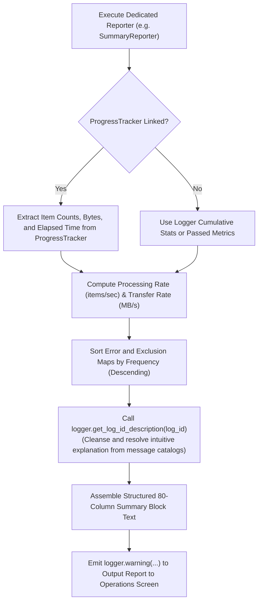

# 2.5. Standard Summary Reporter (`StandardSummaryReporter`) & Log ID Lookup

> **Module**: `agent_common.summary_reporter.StandardSummaryReporter` / `agent_common.logger.ProjectLogger`  
> **Key Classes/Methods**: `StandardSummaryReporter.log_summary()`, `build_summary_report()`, `ProjectLogger.get_log_id_description()`  
> **Related Classes**: `agent_common.progress_tracker.ProgressTracker`, `agent_common.table_formatter.TableFormatter`  
> **Localization**: `agent_common/src/agent_common/localize/{lang}/summary_reporter_{lang}.yml`

---

## 1. Overview & Enterprise Motivation

Upon the completion of large-scale batch workloads, migrations, or Airflow tasks, operations teams need immediate visibility into core operational metrics:

1. **Total Execution Time & Throughput**: Exact wall-clock duration and processing rate (items/sec).
2. **Outcome Distribution**: Numbers of items succeeded, failed, and intentionally skipped/excluded (`Total = Success + Failed + Excluded`).
3. **Categorized Error & Exclusion Diagnostics**: Exact breakdowns of error codes with human-readable explanations.
4. **Data Transfer Bandwidth**: Total volume transferred (MB) and average network transfer rate (MB/s).

Historically, monolithic summary formatting in a generic logger led to rigid report shapes that could not adapt to diverse service domains (e.g. Dell ECS, Google Cloud Storage, BigQuery).

In v0.4.101, adhering to the **Single Responsibility Principle (SRP, Rule 1.4.1)** and **MSA Service Decoupling (Rule 1.4.7)**, `agent_common` introduces **`StandardSummaryReporter`**, a dedicated, multilingual reporting utility that encapsulates the universal **3-way classification ('Success / Failed / Excluded')** and generates clean 80-column Markdown tables, while keeping `ProjectLogger` lightweight and focused purely on logging and metrics capture.

In addition, `ProjectLogger` provides **`get_log_id_description()`**, a dedicated, high-precision reverse lookup and text cleansing engine that all domain reporters can leverage to produce clean localized diagnostics.

---

## 2. Summary Report Architecture



---

## 3. Key Capabilities & Implementation

### 3.1. Precision Log ID Description Cleansing & Lookup (`get_log_id_description`)
Given error or exclusion codes (e.g. `db_deleted_status_skipped`, `network_timeout`, `config_load_failed`), this method inspects the multilingual catalogs (`logging_messages_*.yml`) and applies sophisticated cleansing rules:

1. **Parenthesis `()` Content Removal**: Strips parentheses and enclosed text first so colons inside metadata (e.g. `(Path: ...)`) do not trigger premature truncation.
2. **Punctuation Splitting (`\.\s+|\.$|。|:|：`)**: Truncates long, wordy descriptions while protecting file extensions (e.g. `config.yml`) and semantic versions (`1.0.0`) via the regex pattern `\.\s+|\.$` and ideographic full stop `。`.
3. **Bracket `[TAG]` Removal**: Strips metadata bracket tags (e.g. `[File={file_path_str}]`) cleanly.
4. **Automatic `self.service_name_str` Injection**: When `service_name_str` is bound to the logger instance, it automatically substitutes into `{service_name}` and `{service_name_str}` for complete context.
5. **Placeholder `{}` Retention & Cleanup**: Keeps unreplaced curly brace placeholders intact and cleanly trims quotes and boundary punctuation (` -:,.。：`).

- Code: `db_deleted_status_skipped`
- Output: `* db_deleted_status_skipped (Record excluded due to expired asset status 09): 120 items`

---

## 4. Standard Summary Report Output Format

```text
================================================================================
                    [Data Pipeline Sync Execution Summary]
================================================================================
- Start / End Time       : 2026-09-04 22:00:00 ~ 2026-09-04 22:05:30
- Total Duration         : 5m 30.0s (330.00s)
--------------------------------------------------------------------------------
- Total Target Items     : 100,000 items
- Succeeded / Failed     : 99,500 items / 300 items
- Excluded (Skip)        : 200 items
- Error Details (Total 300 items):
  * network_timeout (Network connection timeout): 250 items
  * schema_mismatch (Required column missing or type mismatch): 50 items
- Exclusion Details (Total 200 items):
  * db_deleted_status_skipped (Excluded due to deleted record status): 150 items
  * db_duplicate_pk_skipped (Primary key duplicate skipped): 50 items
- Total Data Transferred : 1,024.50 MB (Avg 3.10 MB/s)
- Average Throughput     : 303.03 items/sec
- [User Info] Pipeline Worker ID: Airflow_Worker_03
================================================================================
```

---

## 5. Practical Code Examples

### 5.1. Invoking StandardSummaryReporter in a Single Line (Recommended)

```python
from agent_common.logger import ProjectLogger
from agent_common.summary_reporter import StandardSummaryReporter

logger = ProjectLogger("MigrationService", service_name_str="BigQuery")

# 1. Execute runtime tasks and track metrics
logger.record_success(count_int=950)
logger.record_failure(count_int=30, log_id_str="network_timeout")
logger.record_excluded("db_deleted_status_skipped", count_int=50)

# 2. Emit standard 80-column execution summary table at WARNING level
StandardSummaryReporter(logger).log_summary(task_name_str="BigQuery Migration")
```

### 5.2. ProgressTracker Integration & Direct Markdown String Retrieval

```python
from agent_common.logger import ProjectLogger
from agent_common.progress_tracker import ProgressTracker
from agent_common.summary_reporter import StandardSummaryReporter

logger = ProjectLogger("BatchPipeline")
tracker = ProgressTracker(total_items_int=1000, task_name_str="Data Transform")

# Perform processing in batch loop, calling tracker.update(...) and logger.record_*
...

# Retrieve Markdown string to send to external webhooks (Slack/Email) or log directly
reporter = StandardSummaryReporter(logger)
report_markdown_str = reporter.build_summary_report(
    tracker_obj=tracker,
    extra_lines_list=["Operator: Batch_Worker_01", "Target Bucket: raw-data-backup"],
)
logger.warning("execution_summary_report", summary_str=report_markdown_str)
```

---

## 6. Operational Best Practices

1. **`WARNING` Level Visibility**:
   - Final execution summary reports should be emitted at `WARNING` level so operators can review them even in production environments where `INFO` logging is filtered out (`logging.level: WARNING`).
2. **Domain-Specific Reporter Extensibility (MSA Principle)**:
   - `StandardSummaryReporter` guarantees the essential "Success / Failed / Excluded" 3-way distribution across any task.
   - For pipelines requiring specialized tables (e.g. `ExtensionSummaryReporter` in `bucket_test`), developers can compose or extend `StandardSummaryReporter` to append custom domain sections without reinventing core summary logic.
3. **Automated 4-Language Table Localization**:
   - All table headers and metrics ("Category", "Metric", "Execution Time", etc.) are automatically localized according to `logging.language_str` (`KO`, `EN`, `JA`, `ZH`) via `summary_reporter_{lang}.yml`.
