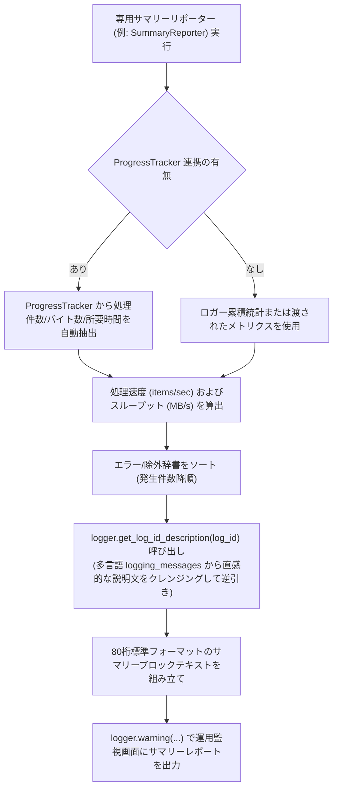

# 2.5. 標準処理結果サマリーリポーター (`StandardSummaryReporter`) およびログ ID 説明逆引き

> **所属モジュール**: `agent_common.summary_reporter.StandardSummaryReporter` / `agent_common.logger.ProjectLogger`  
> **中核クラス/メソッド**: `StandardSummaryReporter.log_summary()`, `build_summary_report()`, `ProjectLogger.get_log_id_description()`  
> **連携モジュール**: `agent_common.progress_tracker.ProgressTracker`, `agent_common.table_formatter.TableFormatter`  
> **多言語設定**: `agent_common/src/agent_common/localize/{lang}/summary_reporter_{lang}.yml`

---

## 1. 概要およびエンタープライズにおける背景

エンタープライズデータパイプライン（Airflow DAG, バッチプロセス）や大規模データ移行が完了した際、エンジニアおよび運用チームは以下の重要事項を即座に確認できる必要があります:

1. **全体の所要時間およびスループット（処理速度）はどれくらいか？**
2. **成功／失敗／除外（Skip）件数はそれぞれ何件か？（全体 = 成功 + 失敗 + 除外の整合性）**
3. **失敗や除外が発生した場合、具体的にどのエラー/除外理由コードが何件発生したか？**
4. **転送・ロードされた総データ容量（MB）と平均ネットワークスループット（MB/s）は適正か？**

従来は汎用ロガー内に特定のレポート形式（`log_summary`）が密結合しており、パイプライン（Dell ECS、Google Cloud Storage、BigQuery 等）ごとに異なるメトリクス要件に対応しづらい課題がありました。

v0.4.101 では、**単一責任原則 (SRP, 規則 1.4.1)** および **MSA 独立サービス分離 (規則 1.4.7)** に従い、ロギング本体である `ProjectLogger` を軽量かつ堅牢に保ちつつ、あらゆるバッチ処理に共通する **「成功／失敗／除外」の 3 大分類** と **多言語対応 80 列標準 Markdown 表** の生成を担う **`StandardSummaryReporter`** ユーティリティクラスを独立提供します。

また、`ProjectLogger` はすべてのドメインリポーターが共通で活用できるよう、**多言語メッセージ辞書逆引き・クレンジングエンジンである `get_log_id_description()`** を高精度に提供します。

---

## 2. サマリーレポート生成アーキテクチャ



---

## 3. 主要機能および詳細動作

### 3.1. エラーおよび除外理由の精密クレンジングと逆引き (`get_log_id_description`)
エラーや除外の識別コード（例: `db_deleted_status_skipped`, `network_timeout`, `config_load_failed`）に基づき、多言語メッセージテンプレート（`logging_messages_*.yml`）から該当定義を動的に逆引きし、以下の高度なクレンジングルールを適用します:

1. **丸括弧 `()` 内容の事前除去**: `(Path: ...)` など付加説明内のコロンによる早期切り捨てを防止するため、丸括弧区間をあらかじめ除去します。
2. **コロンおよび句点基準の分割 (`\.\s+|\.$|。|:|：`)**: 冗長な文章の先頭部分を抽出しますが、正規表現 `\.\s+|\.$` および句点 `。` により `config.yml` などのファイル拡張子や `1.0.0` などのバージョン番号が誤って分割されないよう保護します。
3. **角括弧 `[TAG]` の除去**: `[ファイル={file_path_str}]` などのメタデータタグを綺麗に除去します。
4. **`self.service_name_str` の自動注入**: `ProjectLogger` 生成時にサービス名が設定されている場合、`{service_name}` および `{service_name_str}` に自動置換されます。
5. **未置換波括弧 `{}` の保持および整形**: 未置換のプレースホルダーを保持し、引用符や末尾の不要な区切り文字（` -:,.。：`）をトリムします。

- コード: `db_deleted_status_skipped`
- 出力: `* db_deleted_status_skipped (削除状態コードによる登録対象除外): 120 件`

---

## 4. 標準サマリーレポート出力フォーマット例

```text
================================================================================
                    [データパイプライン同期処理結果サマリー]
================================================================================
- 処理開始 / 終了時刻   : 2026-09-04 22:00:00 ~ 2026-09-04 22:05:30
- 総所要時間            : 5分 30.0秒 (330.00秒)
--------------------------------------------------------------------------------
- 総処理対象件数        : 100,000 件
- 処理成功 / 失敗       : 99,500 件 / 300 件
- 処理除外 (Skip)       : 200 件
- 例外/エラー発生内訳 (計 300件):
  * network_timeout (ネットワーク接続タイムアウト): 250 件
  * schema_mismatch (必須カラム欠落または型不一致): 50 件
- 処理除外内訳 (計 200件):
  * db_deleted_status_skipped (削除状態コードによる登録対象除外): 150 件
  * db_duplicate_pk_skipped (主キー重複除外): 50 件
- 総転送データ容量      : 1,024.50 MB (平均 3.10 MB/s)
- 平均処理速度          : 303.03 items/sec
- [ユーザー追加情報] ワーカー ID: Airflow_Worker_03
================================================================================
```

---

## 5. 実践使用コード

### 5.1. StandardSummaryReporter の 1 行呼び出し（推奨）

```python
from agent_common.logger import ProjectLogger
from agent_common.summary_reporter import StandardSummaryReporter

logger = ProjectLogger("MigrationService", service_name_str="BigQuery")

# 1. 実行時タスク処理およびメトリクス集計
logger.record_success(count_int=950)
logger.record_failure(count_int=30, log_id_str="network_timeout")
logger.record_excluded("db_deleted_status_skipped", count_int=50)

# 2. 標準サマリーリポーター実行（1 行で WARNING レベル出力）
StandardSummaryReporter(logger).log_summary(task_name_str="BigQuery データ移行")
```

### 5.2. ProgressTracker 連携およびレポート文字列の直接取得

```python
from agent_common.logger import ProjectLogger
from agent_common.progress_tracker import ProgressTracker
from agent_common.summary_reporter import StandardSummaryReporter

logger = ProjectLogger("BatchPipeline")
tracker = ProgressTracker(total_items_int=1000, task_name_str="ファイル変換")

# バッチループ中に tracker.update(...) および logger.record_* を実行
...

# 文字列として取得し、外部通知（Slack/メール等）へ送信またはログ出力
reporter = StandardSummaryReporter(logger)
report_markdown_str = reporter.build_summary_report(
    tracker_obj=tracker,
    extra_lines_list=["担当ワーカー: Batch_Worker_01", "対象バケット: raw-data-backup"],
)
logger.warning("execution_summary_report", summary_str=report_markdown_str)
```

---

## 6. 運用ベストプラクティス

1. **`WARNING` レベル出力の標準化**:
   - 最終サマリーレポートは、情報ログ（`INFO`）が無効化された本番環境（`logging.level: WARNING`）でも運用担当者が確実に確認できるよう、`WARNING` レベルで出力することを推奨します。
2. **ドメイン専用リポーター拡張 (MSA 原則)**:
   - `StandardSummaryReporter` はあらゆるバッチ処理で必須となる「成功／失敗／除外」の 3 大分類を完備しています。
   - `bucket_test` の `ExtensionSummaryReporter` のように拡張子別内訳やストレージ固有の表が必要な場合は、`StandardSummaryReporter` を組み合わせ（Composition）または継承して独自セクションを簡単に追加できます。
3. **多言語（4 か国語）表の自動ローカライズ**:
   - 表ヘッダー（「区分」、「処理件数」、「実行時間」など）は `summary_reporter_{ko,en,ja,zh}.yml` により言語設定（`KO`, `EN`, `JA`, `ZH`）に応じて 100% 自動ローカライズされます。
