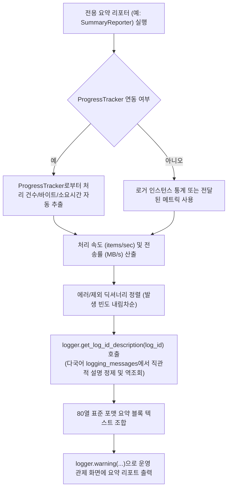

# 2.5. 표준 작업 결과 요약 리포터 (`StandardSummaryReporter`) 및 로그 ID 설명 역조회

> **소속 모듈**: `agent_common.summary_reporter.StandardSummaryReporter` / `agent_common.logger.ProjectLogger`  
> **핵심 클래스/메서드**: `StandardSummaryReporter.log_summary()`, `build_summary_report()`, `ProjectLogger.get_log_id_description()`  
> **연계 모듈**: `agent_common.progress_tracker.ProgressTracker`, `agent_common.table_formatter.TableFormatter`  
> **다국어 설정**: `agent_common/src/agent_common/localize/{lang}/summary_reporter_{lang}.yml`

---

## 1. 개요 및 엔터프라이즈 배경

엔터프라이즈 데이터 파이프라인(Airflow DAG, 배치 프로세스)이나 대규모 데이터 마이그레이션이 완료되었을 때, 엔지니어와 운영팀은 다음과 같은 핵심 질문에 즉시 답할 수 있어야 합니다:

1. **전체 작업 소요 시간과 처리 속도(Throughput)는 얼마인가?**
2. **성공/실패/제외(Skip) 건수가 각각 몇 건인가? (전체 = 성공 + 실패 + 제외 정합성)**
3. **실패나 제외가 발생했다면 구체적으로 어떤 오류/사유 코드가 몇 건씩 발생했는가?**
4. **전송/적재된 총 데이터 용량(MB)과 평균 네트워크 전송률(MB/s)은 적정 수준인가?**

과거에는 각 배치 스크립트마다 `print()`나 로그를 제각각 구성하여 포맷이 통일되지 않았고, 에러 코드만 암호처럼 출력되어 즉각적인 원인 파악이 어려웠습니다.

v0.4.101에서는 **단일 책임 원칙(SRP, 규칙 1.4.1)** 및 **MSA 독립 서비스 분리(규칙 1.4.7)** 에 따라, 로깅 엔진 본체인 `ProjectLogger`를 가볍고 견고하게 유지하면서도 모든 배치 작업의 보편적 공통 분모인 **'성공 / 실패 / 제외' 3대 분류**와 **다국어 80열 표준 요약 마크다운 표** 생성을 전담하는 **`StandardSummaryReporter`** 유틸리티 클래스를 제공합니다.

또한 `ProjectLogger`는 모든 도메인 요약 리포터가 공통으로 활용할 수 있도록 **다국어 메시지 사전 역조회 및 정제 엔진인 `get_log_id_description()`** 을 정교하게 제공합니다.

---

## 2. 요약 리포트 생성 아키텍처



---

## 3. 핵심 기능 및 상세 동작

### 3.1. 에러 및 제외 사유 설명 정밀 정제 및 역조회 (`get_log_id_description`)
에러 및 제외 식별 코드(예: `db_deleted_status_skipped`, `network_timeout`, `config_load_failed`)가 주어지면, 다국어 메시지 템플릿(`logging_messages_*.yml`)에서 해당 정의를 동적으로 역추적하고 고도화된 정제 규칙을 적용하여 **직관적인 한글/영문 설명문을 자동으로 결합**합니다:

1. **소괄호 `()` 내용 사전 제거**: `(Path: ...)` 등 부가설명 내에 콜론이 있더라도 조기에 절단되지 않도록 소괄호 구간을 먼저 안전하게 정제합니다.
2. **콜론 및 마침표 기준 분리 (`\.\s+|\.$|。|:|：`)**: 장황한 문장의 헤더를 분리하되, 정규식 `\.\s+|\.$` 및 `。`를 적용하여 `config.yml`과 같은 파일 확장자나 `1.0.0` 같은 버전 번호가 마침표로 인해 오인 절단되지 않도록 보호합니다.
3. **`[TAG]` 대괄호 태그 제거**: `[파일={file_path_str}]` 등 헤더 뒤에 붙는 식별 태그를 안전하게 정제합니다.
4. **`self.service_name_str` 자동 주입**: `ProjectLogger` 생성 시 서비스명이 지정되어 있으면 `{service_name}` 및 `{service_name_str}`에 자동 치환되어 완전한 문맥을 제공합니다.
5. **미치환 중괄호 `{}` 보존 및 공백/따옴표 정제**: 미치환된 플레이스홀더를 무리하게 지우지 않고 보존하며, 따옴표나 불필요한 양끝 구두점(` -:,.。：`)을 정제합니다.

- 코드: `db_deleted_status_skipped`
- 출력: `* db_deleted_status_skipped (삭제 상태코드로 인한 적재 대상 제외): 120 건`

---

## 4. 표준 요약 리포트 출력 포맷 예시

```text
================================================================================
                    [데이터 파이프라인 동기화 작업 결과 요약]
================================================================================
- 작업 시작 / 종료 시간 : 2026-09-04 22:00:00 ~ 2026-09-04 22:05:30
- 총 소요 시간          : 5분 30.0초 (330.00초)
--------------------------------------------------------------------------------
- 총 처리 대상 건수     : 100,000 건
- 처리 성공 / 실패      : 99,500 건 / 300 건
- 처리 제외 (Skip)      : 200 건
- 예외/오류 발생 세부 내역 (총 300건):
  * network_timeout (네트워크 연결 시간 초과): 250 건
  * schema_mismatch (필수 컬럼 누락 또는 타입 불일치): 50 건
- 처리 제외 세부 내역 (총 200건):
  * db_deleted_status_skipped (삭제 상태코드로 인한 적재 대상 제외): 150 건
  * db_duplicate_pk_skipped (이미 존재하거나 중복된 기본키 제외): 50 건
- 총 전송 데이터 용량   : 1,024.50 MB (평균 3.10 MB/s)
- 평균 처리 속도        : 303.03 items/sec
- [사용자 추가 정보] 파이프라인 배치 실행자: Airflow_Worker_03
================================================================================
```

---

## 5. 실전 사용 코드

### 5.1. StandardSummaryReporter 단 한 줄 호출 (가장 권장)

```python
from agent_common.logger import ProjectLogger
from agent_common.summary_reporter import StandardSummaryReporter

logger = ProjectLogger("MigrationService", service_name_str="BigQuery")

# 1. 런타임 작업 수행 및 통계 수집
logger.record_success(count_int=950)
logger.record_failure(count_int=30, log_id_str="network_timeout")
logger.record_excluded("db_deleted_status_skipped", count_int=50)

# 2. 표준 요약 리포터 실행 (단 한 줄로 WARNING 레벨 출력)
StandardSummaryReporter(logger).log_summary(task_name_str="빅쿼리 데이터 이관")
```

### 5.2. ProgressTracker 연동 및 리포트 문자열 직접 반환

```python
from agent_common.logger import ProjectLogger
from agent_common.progress_tracker import ProgressTracker
from agent_common.summary_reporter import StandardSummaryReporter

logger = ProjectLogger("BatchPipeline")
tracker = ProgressTracker(total_items_int=1000, task_name_str="파일 변환")

# 배치 루프 진행 중 tracker.update(...) 및 logger.record_* 수행
...

# 문자열로 받아 외부 메신저(Slack/이메일 등)로 전송하거나 로그 출력
reporter = StandardSummaryReporter(logger)
report_markdown_str = reporter.build_summary_report(
    tracker_obj=tracker,
    extra_lines_list=["담당 작업자: 배치 워커 01", "타깃 버킷: raw-data-backup"],
)
logger.warning("execution_summary_report", summary_str=report_markdown_str)
```

---

## 6. 운영 베스트 프랙티스

1. **`WARNING` 레벨 로깅의 목적**:
   - 최종 작업 요약 리포트는 정보성 로그(`INFO`)가 비활성화된 프로덕션 환경(`logging.level: WARNING`)에서도 운영자가 반드시 확인할 수 있도록 `WARNING` 레벨로 출력하는 것을 표준으로 삼습니다.
2. **도메인별 특화 리포터 확장 (MSA 원칙)**:
   - `StandardSummaryReporter`는 어떤 배치 작업이든 필수적인 "성공/실패/제외" 3대 분류를 완벽하게 담당합니다.
   - `bucket_test`의 `ExtensionSummaryReporter`처럼 파일 확장자별 통계나 스토리지 전용 세부 표가 추가로 필요한 도메인의 경우, `StandardSummaryReporter`를 조합(Composition)하거나 상속하여 도메인 특화 섹션을 손쉽게 덧붙일 수 있습니다.
3. **다국어(4개국어) 표 자동 로컬라이징**:
   - 표 헤더("구분", "처리 건수", "실행 시간" 등)는 `summary_reporter_{ko,en,ja,zh}.yml`을 통해 언어 설정(`logging.language_str: EN/JA/ZH`)에 따라 100% 자동 로컬라이징되므로 별도의 번역 코드를 작성할 필요가 없습니다.
