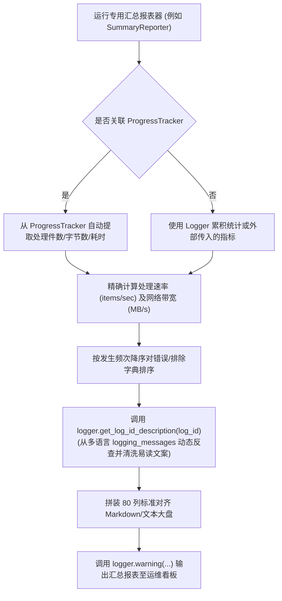

# 2.5. 标准任务执行结果汇总报告器 (`StandardSummaryReporter`) 与日志 ID 反查

> **所属模块**: `agent_common.summary_reporter.StandardSummaryReporter` / `agent_common.logger.ProjectLogger`  
> **核心类/方法**: `StandardSummaryReporter.log_summary()`, `build_summary_report()`, `ProjectLogger.get_log_id_description()`  
> **关联模块**: `agent_common.progress_tracker.ProgressTracker`, `agent_common.table_formatter.TableFormatter`  
> **多语言配置**: `agent_common/src/agent_common/localize/{lang}/summary_reporter_{lang}.yml`

---

## 1. 概述与企业级应用背景

当企业级数据管道（Airflow DAG、定时批处理进程）或大规模数据迁移结束时，运维与研发团队必须能够第一时间回答以下核心问题：

1. **整体任务耗时多长？平均处理吞吐量 (Throughput) 是多少？**
2. **成功、失败、过滤排除 (Skip) 各有多少条？（总计 = 成功 + 失败 + 跳过 严格一致）**
3. **若存在失败或跳过，具体由哪些错误/原因代码构成、各发生多少次？**
4. **整体传输与入库的数据总量 (MB) 及平均网络带宽 (MB/s) 表现如何？**

以往通用日志器内部强耦合了固定的报表格式（`log_summary`），难以灵活满足不同领域服务（如 Dell ECS、Google Cloud Storage、BigQuery 等）的专属指标诉求。

在 v0.4.101 中，遵循**单一职责原则 (SRP, 规则 1.4.1)** 与 **MSA 微服务独立解耦原则 (规则 1.4.7)**，`agent_common` 保持日志核心 `ProjectLogger` 轻量与高内聚，同时提供独立通用的 **`StandardSummaryReporter`** 工具类，专职承接所有批处理任务通用的 **“成功 / 失败 / 跳过”三大分类** 与 **多语言 80 列标准对齐 Markdown 表格** 的组装输出。

与此同时，`ProjectLogger` 保留并重构了**多语言消息字典反查与文案清洗引擎 `get_log_id_description()`**，为所有领域的专属报表器提供高精度、标准化的错误与排除原因文案支持。

---

## 2. 汇总报表生成架构



---

## 3. 核心功能与机制

### 3.1. 错误及排除原因高精度清洗与反查 (`get_log_id_description`)
给定错误或排除标识代码（如 `db_deleted_status_skipped`、`network_timeout`、`config_load_failed`），该方法动态检索多语言消息字典（`logging_messages_*.yml`），并执行以下精密清洗流程：

1. **小括号 `()` 内容预先剔除**: 提前移除补充说明括号，防止括号内冒号（如 `(Path: ...)`）导致整句被过早截断。
2. **冒号与句号分词截断 (`\.\s+|\.$|。|:|：`)**: 自动切分冗长语句提取标题，并通过正则表达式 `\.\s+|\.$` 及句号 `。` 保护 `config.yml` 等文件后缀及 `1.0.0` 语义化版本号不被误切。
3. **方括号 `[TAG]` 剔除**: 干净剔除标题后附加的元数据标签（如 `[文件={file_path_str}]`）。
4. **自动注入 `self.service_name_str`**: 若初始化 `ProjectLogger` 时传入了服务名称，会自动替换模板中的 `{service_name}` 与 `{service_name_str}`，提供完整上下文。
5. **未替换花括号 `{}` 保留与修整**: 完整保留未替换的模板占位符，并清理多余引号及边界标点符号（` -:,.。：`）。

- 代码: `db_deleted_status_skipped`
- 输出: `* db_deleted_status_skipped (因删除状态码排除入库): 120 条`

---

## 4. 标准汇总报表输出大盘格式

```text
================================================================================
                    [数据管道同步执行结果汇总报表]
================================================================================
- 任务开始 / 结束时间   : 2026-09-04 22:00:00 ~ 2026-09-04 22:05:30
- 总耗时                : 5分 30.0秒 (330.00秒)
--------------------------------------------------------------------------------
- 总处理条目数          : 100,000 条
- 处理成功 / 失败       : 99,500 条 / 300 条
- 过滤排除 (Skip)       : 200 条
- 异常/错误发生明细 (共 300条):
  * network_timeout (网络连接超时): 250 条
  * schema_mismatch (必填字段缺失或类型不匹配): 50 条
- 过滤排除明细 (共 200条):
  * db_deleted_status_skipped (因删除状态码排除入库): 150 条
  * db_duplicate_pk_skipped (主键重复排除): 50 条
- 传输数据总量          : 1,024.50 MB (平均 3.10 MB/s)
- 平均处理吞吐率        : 303.03 items/sec
- [附加元数据] Worker ID: Airflow_Worker_03
================================================================================
```

---

## 5. 实战调用代码

### 5.1. StandardSummaryReporter 单行快捷调用（官方推荐）

```python
from agent_common.logger import ProjectLogger
from agent_common.summary_reporter import StandardSummaryReporter

logger = ProjectLogger("MigrationService", service_name_str="BigQuery")

# 1. 业务处理与统计累加
logger.record_success(count_int=950)
logger.record_failure(count_int=30, log_id_str="network_timeout")
logger.record_excluded("db_deleted_status_skipped", count_int=50)

# 2. 运行标准汇总报告器（单行即可输出 80 列 WARNING 级别大盘）
StandardSummaryReporter(logger).log_summary(task_name_str="BigQuery 数据迁移")
```

### 5.2. 联动 ProgressTracker 与直接获取 Markdown 字符串

```python
from agent_common.logger import ProjectLogger
from agent_common.progress_tracker import ProgressTracker
from agent_common.summary_reporter import StandardSummaryReporter

logger = ProjectLogger("BatchPipeline")
tracker = ProgressTracker(total_items_int=1000, task_name_str="文件转换")

# 在批处理循环中执行 tracker.update(...) 与 logger.record_*
...

# 获取 Markdown 字符串直接发送至外部群聊 (如 Slack/邮件) 或记录日志
reporter = StandardSummaryReporter(logger)
report_markdown_str = reporter.build_summary_report(
    tracker_obj=tracker,
    extra_lines_list=["执行节点: Batch_Worker_01", "目标桶: raw-data-backup"],
)
logger.warning("execution_summary_report", summary_str=report_markdown_str)
```

---

## 6. 运维最佳实践

1. **`WARNING` 级别输出规范**:
   - 最终执行汇总报表应统一以 `WARNING` 级别输出，确保即使在生产环境过滤了信息性日志（`logging.level: WARNING`）时，运维人员依然能稳定查阅报表大盘。
2. **领域专属报表器扩展 (MSA 原则)**:
   - `StandardSummaryReporter` 完整保障了任何任务不可或缺的“成功 / 失败 / 跳过”三大核心分类。
   - 针对需要扩展特殊维度（如 `bucket_test` 的 `ExtensionSummaryReporter` 文件后缀统计、分区表格）的服务，可通过组合 (Composition) 或继承方式无缝附加领域专属表格。
3. **多语言（4 种语言）表格自动本地化**:
   - 表头（“类别”、“处理计数”、“执行时间”等）均通过 `summary_reporter_{ko,en,ja,zh}.yml` 根据语言配置（`KO`, `EN`, `JA`, `ZH`）100% 自动本地化渲染，无需手动翻译。
